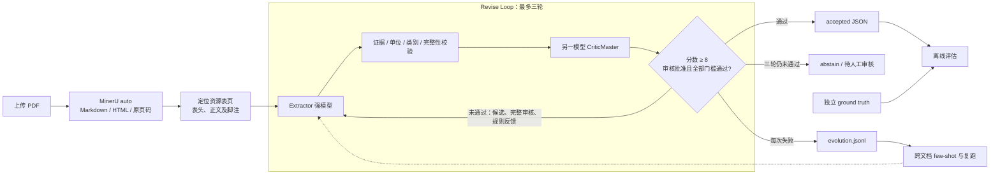

# NI 43-101 Resource Auditor

从上传的矿业技术报告抽取 **Indicated / Inferred Mineral Resources**，由第二个模型独立审查，再用可重复的证据、单位和数值规则决定接受或弃答。最多三轮；无法确认时输出 `abstain`，标注人工审核，并保留每轮候选及原因。

这是面试题三的可运行实现，面向评审方自行上传的未知 PDF 和独立 ground truth。无需取得招聘方的三份文件，也不按公司名或文件名分支。应用代码由 Codex 辅助开发，复用 FastAPI、Pydantic 和 [MinerU](https://github.com/opendatalab/MinerU)。默认 Docker 镜像包含 MinerU 4.0.12、Basic CPU 模型及本地视觉模型。来源与许可见 [NOTICE.md](NOTICE.md)。

**开始使用：[RUN.md](RUN.md)**。本地网页提供 PDF 上传、结果下载和单独的 ground truth 评分；也可使用 CLI 或 FastAPI。工程使用 `src/` 布局、锁定依赖、类型化 JSON schema、测试、Ruff、CI 和单进程 Docker 服务。

评审方可直接克隆公开仓库或下载源码 ZIP，按 [Docker 快速部署](RUN.md#评审方快速部署docker) 复制并填写两个模型 API 的 `.env`，运行 `docker compose up --build -d`，打开 `http://127.0.0.1:8000`。无需单独安装 Python、MinerU、OCR 模型或配置解析器路径，也无需 GPU，建议准备至少 16 GB 内存供复杂页视觉重解析使用。首次构建联网下载依赖和 OCR 模型；随后 OCR 使用镜像内模型。仓库不附带模型密钥，API 密钥由测试方自行配置。

## 对应交付要求

| 要求 | 实现 |
| --- | --- |
| Extractor Agent | 独立配置的强模型，schema 约束及原始表格证据 |
| CriticMaster Agent | 不同模型标识、独立提示词，输出 1–10 分、批准、完整性及问题 |
| ≤3 轮、≥8 才通过 | 三次抽取+审核；分数、批准、完整性、规则、未解决问题均为门槛 |
| 明显错误时弃答 | 单位、引文、类别、算术、重复行、来源行覆盖与身份来源可独立否决高分审核 |
| Evolution Log | 每次失败及后续修订写 JSONL；仅通过规则与审核的修订供其他文档参考 |
| Few-shot 改进与复跑 | `replay` 比较无示例与有示例结果，不回写训练样例，排除当前 PDF 的 SHA-256 |
| 字段 accuracy ±5% | 数值逐字段评分，单位归对应字段；同时报告覆盖率、额外行和错误候选是否被拒 |
| 评审方自带 PDF / JSON | 上传接口与 CLI；JSON schema 不同时使用显式映射，答案不进入抽取流程 |

## Revise Loop

`engine.audit()` 在 `range(1, 4)` 中依次调用抽取、规则校验和独立审核。第二、三轮的输入包含原始来源、上一轮候选 `previous`、完整审核 `previous_review`（分数、批准、完整性及问题）、合并的规则/审核 `feedback` 和字面原文修正窗口。首次没有历史候选；失败轮写入演化日志。修订成功也记录前后结果，供其他文档的 few-shot 使用；同一 PDF 的 SHA-256 会被排除。没有可用成功修订时 few-shot 为空，不把失败答案直接当正确示例。

三轮仍不满足全部门槛即 `abstain`、`requires_manual_review=true`、最终 `rows=[]`，各轮候选与批评仍在 `attempts` 中。解析失败、超预算或接口不可用可提前弃答，三轮是上限，不强制为无效输入花满三轮。Ground truth 只参与之后的离线评分。

## 接受门槛与范围

`score >= 8` 不是单独的成功条件。必须同时满足：不同模型；Critic 批准且范围完整、无阻断问题；候选非空且无未解决字段；引文来自指定页；数值及单位与引文相符；算术在报告的舍入区间内合理；没有重复或错误类别。`notes` 保存说明性意见，不影响批准，也不能抵消任何阻断问题。最终 `rows` 只包含接受结果；弃答的候选位于 `attempts`，供人工排查。

多表、无边框表和同页混合布局均核对可识别来源行；无法建立清单时以 `scope_completeness_unverified` 阻断，而不是跳过完整性检查。项目、表号、日期、basis、cutoff 有弱来源核验，无法定位时以 `unverified_identity` 阻断。具体支持边界见 [DATA_NOTES.md](DATA_NOTES.md)；这些规则仍不能证明所有版面关联或整份报告定位完整。

Indicated/Inferred 在此指 **资源量**，不等同于 Proven/Probable **储量**。默认只接受 NI 43-101。JORC 和 Li₂O 为额外测试范围，必须开启 `allow_jorc`；Li₂O 保存为氧化物吨数，不冒充金属锂。缺失金属量、删失数值或全为横线的字段不会用乘法补成“抽取结果”。

自动选择同时出现资源类别、矿石量/品位表头和数值行的页面，不再因正文提及类别就加入相邻页。最多 24 页、100,000 字符，超出预算仍弃答。自动定位是启发式：结果列出实际 `selected_pages`；跨页续表、无常规表头或复杂布局仍可能漏选，因此 `selection_scope=automatic` 也不能证明整份报告完整。评审方应核对范围，必要时指定页码。指定页码时 `selection_scope=explicit`，接受只表示所选范围通过。原始报告中不同日期、位置、cutoff 和权益口径保留为独立记录；总计与分项可能重叠，不进行跨行求和。

## 统一 MinerU 解析

中英文、原生文本、扫描件和混合 PDF 全部使用 **MinerU 4.x 官方 SDK**，由 `ocr_mode=auto` 自动处理文本与 OCR，不再使用 pdfplumber，也没有其他解析器回退。Docker 已包含独立解释器、Basic ONNX CPU 模型及 llama.cpp 视觉模型，无需用户判断 PDF 类型或再配置解析器。

空页码上传时，MinerU 解析整份报告，再定位资源页；指定页码时，解析指定页及前十页的标准证据，保留原始 `page_idx` 对应的 PDF 页序。MinerU 的 Markdown/HTML 保持原样作为引文来源；HTML 的 `rowspan/colspan` 展开为结构视图，简单 Markdown 表也建立列映射，供单位、类别和来源行覆盖规则使用。结构视图不替代引文。无法建立来源行清单的资源页自动使用 MinerU Advanced 的本地视觉模型重解析，仅采用能够核验且保留已有明确行的结果，写入解析说明；仍有类别拼接或位置分组冲突时弃答。缺页、超时、解析失败或不可核验的表格都会阻断并转人工审核。

默认每批处理八页、单个渲染进程，限制嵌套数值计算线程，降低整份报告解析的内存峰值；这些设置不改变抽取范围。整份解析超时默认 1800 秒（30 分钟），可调低；输入最多 1000 页，抽取上下文仍受 24 页 / 100,000 字符预算约束。模式及非 Docker 安装见 [RUN.md](RUN.md#6-统一-mineru-解析所有-pdf)。

OCR 的证据是解析文本，两个模型未直接审核原始页面图像；一致的 OCR 错误仍可能漏检。中文类别没有明确的 Indicated/Inferred 对照时不能套用其他资源分类，当前没有中文真实报告准确率结论。

## 评估与已知限制

公开开发集包括 Barrick Reko Diq、Kinross Great Bear、Newmont Tanami 和额外的 Pilbara JORC 样本。下载地址、SHA-256、限定页码及 23 条手工核对的数值记录在 `examples/`；默认自动范围有另行标注。Newmont 的选页与抽取结果分别报告，不将选页成功视为抽取成功。原 PDF 不入 Git。它们是开发参考数据，未由发行方提供 ground truth，不能代替未知报告的独立评测。

当前整份公开开发回归：Newmont 36/36、Barrick 60/60、Pilbara（额外 JORC）39/39；Kinross 第 155 页的方法分组无法核验，安全弃答、0% 覆盖。不能把旧版 Kinross 成绩当作新解析器通过证据。

测试与真实模型结果记录在 [EVAL_RESULTS.md](EVAL_RESULTS.md)。拒绝所有结果会得到零覆盖率和零全量准确率，不能伪装为满分。复跑的接受率提高也不等于准确率提高，必须继续用独立 truth 评分。

本项目为本地单进程验收工具：每进程同时最多两份报告；日志使用进程内锁。Docker 默认 Basic CPU 模式，并捆绑 Advanced 重解析所需的 ONNX 小模型及 llama.cpp GGUF/mmproj 权重；复杂版面仍可能解析失败，不能保证未知报告的 OCR 准确率。没有用户权限、外网发布、分布式任务队列或 OCR 图像级交叉校验。不同模型标识无法证明网关没有将两个别名路由到相同底层模型，部署方应确认实际路由。

模型接口支持 OpenAI-compatible `/chat/completions` 和原生 Anthropic `/messages`，分别设置角色的 `API_FORMAT=chat` 或 `anthropic`；支持流式响应和截断检查。开发验收按用户偏好使用 DeepSeek 抽取、Qwen 审核。OpenAI `/responses` 尚未接入。模型 API 会收到所选页面文本与少量跨文档修订示例；私密报告应使用获准的服务，并关闭不合适的 few-shot 共享。

支持按角色选择严格 JSON Schema 与 Qwen 思考开关，默认不发送这些可选参数，须确认接口支持再启用。直连接口和 OpenCode Go 配置均见 [RUN.md](RUN.md)。公开自动范围标注单独保存在 `*.automatic.truth.json`；只有选页范围一致才评分，保持答案与模型提示隔离。
