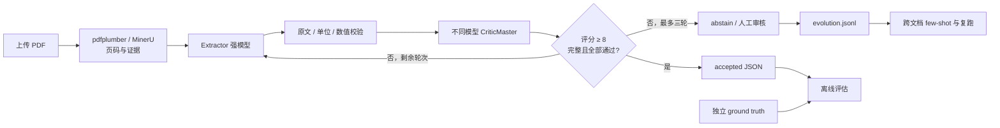

# NI 43-101 Resource Auditor

从上传的矿业技术报告抽取 **Indicated / Inferred Mineral Resources**，由第二个模型独立审查，再用可重复的证据、单位和数值规则决定接受或弃答。最多三轮；无法确认时输出 `abstain`，标注人工审核，并保留每轮候选及原因。

这是面试题三的可运行实现，面向评审方自行上传的未知 PDF 和独立 ground truth。无需取得招聘方的三份文件，也不按公司名或文件名分支。应用代码由 Codex 辅助开发，复用 pdfplumber、FastAPI、Pydantic 和可选的 [MinerU](https://github.com/opendatalab/MinerU)。来源与许可见 [NOTICE.md](NOTICE.md)。

**开始使用：[RUN.md](RUN.md)**。本地网页提供 PDF 上传、结果下载和单独的 ground truth 评分；也可使用 CLI 或 FastAPI。工程使用 `src/` 布局、锁定依赖、类型化 JSON schema、测试、Ruff、CI 和单进程 Docker 服务。

## 对应交付要求

| 要求 | 实现 |
| --- | --- |
| Extractor Agent | 独立配置的强模型，schema 约束及原始表格证据 |
| CriticMaster Agent | 不同模型标识、独立提示词，输出 1–10 分、批准、完整性及问题 |
| ≤3 轮、≥8 才通过 | 三次抽取+审核；分数、批准、完整性、规则、未解决问题均为门槛 |
| 明显错误时弃答 | 单位倍率、引文、类别、金属量算术、重复行等校验可否决高分审核 |
| Evolution Log | 每次失败及后续修订写 JSONL；仅通过规则与审核的修订供其他文档参考 |
| Few-shot 改进与复跑 | `replay` 比较无示例与有示例结果，不回写训练样例，排除当前 PDF 的 SHA-256 |
| 字段 accuracy ±5% | 数值逐字段评分，单位归对应字段；同时报告覆盖率、额外行和错误候选是否被拒 |
| 评审方自带 PDF / JSON | 上传接口与 CLI；JSON schema 不同时使用显式映射，答案不进入抽取流程 |

## 接受门槛与范围

`score >= 8` 不是单独的成功条件。必须同时满足：不同模型；Critic 批准且范围完整、无问题；候选非空且无未解决字段；引文来自指定页；数值及单位与引文相符；算术在报告的舍入区间内合理；没有重复或错误类别。最终 `rows` 只包含接受结果；弃答的候选位于 `attempts`，供人工排查。

Indicated/Inferred 在此指 **资源量**，不等同于 Proven/Probable **储量**。默认只接受 NI 43-101。JORC 和 Li₂O 为额外测试范围，必须开启 `allow_jorc`；Li₂O 保存为氧化物吨数，不冒充金属锂。缺失金属量、删失数值或全为横线的字段不会用乘法补成“抽取结果”。

自动选择资源表及相邻页，最多 24 页、100,000 字符。超出预算时弃答，要求明确页码；不会把截断内容当作完整报告。指定页码时 `selection_scope=explicit`，接受只表示所选范围通过，不能宣称整份报告完整。原始报告中不同日期、位置、cutoff 和权益口径保留为独立记录；总计与分项可能重叠，不进行跨行求和。

## 中文及扫描 PDF

中文文本或扫描件优先尝试配置好的 **MinerU 4.x 官方 SDK**。它在独立 Python 环境运行，保留原始 `page_idx` 转为一开始的 PDF 页码，不经过在线上传服务。未配置或失败时回退到原文本层，结果注明 `parser` / `parser_notes`；没有可核验文本时弃答。完整安装方法与超时边界见 [RUN.md](RUN.md)。

OCR 的证据是解析文本，两个模型并未直接审阅原始页面图像。版面错位或一致的 OCR 错误仍可能漏检；中文报告类别若没有明确的 Indicated/Inferred 对照，也不能套用中国其他资源分类。当前没有中文真实报告准确率结论。

## 评估与已知限制

公开开发集包括 Barrick Reko Diq、Kinross Great Bear 和额外的 Pilbara JORC 样本。下载地址、SHA-256、限定页码及 17 条手工核对的数值记录在 `examples/`。原 PDF 不入 Git。它们是开发参考数据，未由发行方提供 ground truth，不能代替未知报告的独立评测。

测试与真实模型结果记录在 [EVAL_RESULTS.md](EVAL_RESULTS.md)。拒绝所有结果会得到零覆盖率和零全量准确率，不能伪装为满分。复跑的接受率提高也不等于准确率提高，必须继续用独立 truth 评分。

本项目为本地单进程验收工具：每进程同时最多两份报告；日志使用进程内锁。基础 Docker 服务未安装大型 MinerU 运行时；容器中的中文 OCR 需要自行扩展镜像。没有用户权限、外网发布、分布式任务队列或 OCR 图像级交叉校验。不同模型标识无法证明网关没有将两个别名路由到相同底层模型，部署方应确认实际路由。

模型接口支持 OpenAI-compatible `/chat/completions` 和原生 Anthropic `/messages`，分别设置角色的 `API_FORMAT=chat` 或 `anthropic`；支持流式响应和截断检查。开发验收按用户偏好使用 DeepSeek 抽取、Qwen 审核。OpenAI `/responses` 尚未接入。模型 API 会收到所选页面文本与少量跨文档修订示例；私密报告应使用获准的服务，并关闭不合适的 few-shot 共享。
